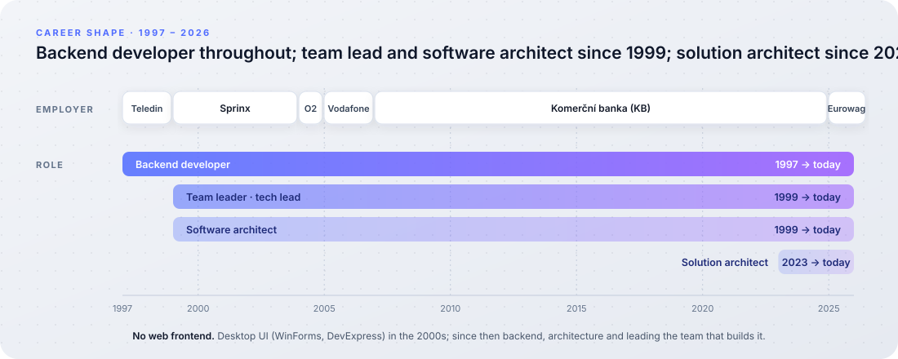

# Ondřej Maléř

**Solution architect and technical team leader — backend, .NET, Azure.** I
design backend systems, lead the team that builds them, and write the critical
parts myself; web frontend is not my area. More than twenty-five years in
software, most of them in banking and mobility. Today I lead the team building
an account-onboarding platform — three of its services are in production and
described below — and I author the AI-assisted development methodology the
team works by.

Moravian-Silesian Region, Czech Republic&nbsp;&nbsp;·&nbsp;&nbsp;[GitHub](https://github.com/ondmal)&nbsp;&nbsp;·&nbsp;&nbsp;[LinkedIn](https://www.linkedin.com/in/ondrej-maler/)

---

## Projects

Three services of one onboarding platform, built 2025–2026 and in production:
the onboarding engine, the signing of the contracts it produces, and the
rendering of the documents that get signed. Each page is a one-page
architecture overview — the problem, the design decisions and their reasons,
the diagrams.

### [Account Onboarding Service](https://ondmal.github.io/account-onboarding/)

A platform for account onboarding: a domain-tailored workflow engine with
variant plugins, a Clean Architecture core shared by a synchronous and an
asynchronous host, and reliable background processing on Azure. The first
channel, self-service onboarding, is delivered end to end from a React
micro-frontend through a BFF to the service.

*Built 2026 · Role: solution architect and senior developer. C# / .NET,
PostgreSQL, Azure, Kubernetes, Azure Functions, OpenTelemetry.*

### [Multi-Party Document Signing Service](https://ondmal.github.io/multi-party-document-signing/)

A service that turns an external single-signatory signing platform into
multi-party document signing for any consuming service: one process across
several signatories that succeeds only when every one of them signs. Reliable
asynchronous processing on Azure with a transactional outbox, idempotent
commands and recovery of missed webhooks.

*Built 2025–2026 · Role: solution architect and senior developer. C# / .NET,
PostgreSQL, Azure, Kubernetes, Azure Functions, OpenTelemetry.*

### [Document Template Rendering Service](https://ondmal.github.io/document-template-rendering/)

A stateless service that fills Word templates with request data and renders
them as signable PDF/A-2u documents — loops, conditional sections, barcodes and
empty signature fields — as the drop-in successor to a legacy templating engine:
same templates, same contract, matching output. A rendering library chosen by
proof of concept, legacy parity engineered as removable features, and the
shipped container image tested before every release.

*Built 2026 · Role: solution architect. C# / .NET, GemBox.Document, Azure,
Kubernetes, OpenTelemetry.*

---

## Topics

Ideas from my experience — the approach I recommend and why, not a report of
what is wired today. The projects above are the evidence a topic points to.

### [Documentation as a source artefact](https://ondmal.github.io/topics/documentation-as-code/)

How to document software components in the age of AI: documentation lives next
to the code and travels with it — written during the change, with an AI agent
doing the mechanical part, reviewed in the pull request, published on merge —
and only what nobody can easily get from the code is written at all.

*Written October 2026.*

---

## Skills

Three tiers, so the list is complete without pretending everything is current.

**Core** — used in production in the last two years; I could teach it.

- **Platform:** C# · .NET 10 · ASP.NET Core minimal APIs
- **Architecture:** Clean Architecture · DDD · ports & adapters · plugin
  architecture · vertical slices · event-driven (transactional outbox,
  idempotency, replay) · microservices
- **Integration & security:** REST · OpenAPI · webhooks · Kafka · Azure Storage
  Queues · OAuth 2.0 / OIDC · workload identity · mTLS
- **Data:** PostgreSQL · EF Core
- **Cloud & runtime:** Azure (AKS, Helm, Key Vault, Functions, Blob & Files
  storage, DevOps pipelines) · Kubernetes · Docker
- **Observability:** OpenTelemetry · Honeycomb (dashboards, SLOs, alerts as
  code)
- **Testing:** TUnit · Testcontainers · WireMock · NetArchTest · container
  end-to-end tests · BenchmarkDotNet
- **Documents:** PDF/A-2u generation (GemBox.Document, PdfSharp)
- **Method & tooling:** AI-assisted development (Claude Code: skills,
  subagents, hooks, MCP; spec-driven generation; review agents) · Scrum · UML ·
  ArchiMate · Enterprise Architect · Azure DevOps

**Working** — used in production, now a step back; a day to warm up.

.NET Framework · SOAP / WCF · Teradata · MS SQL · Oracle · Power BI · Blazor ·
NUnit / xUnit · Confluence

**Past** — real experience, stale; I know what it is and what it costs.

Delphi · Visual Basic · classic ASP · ASP.NET WebForms · WinForms · DevExpress ·
ADO.NET · PL/SQL · .NET Remoting · ASMX web services · IIS · log4net · RUP · XP
· Team Foundation Server

---

## Experience

### Technical team leader, solution architect — Eurowag
*July 2025 – present*

Leading the team that builds the account onboarding platform: team leadership,
planning and estimation, architecture and design of the backend services, code
review, and technical documentation. The services are the three described under
*Projects*.

- **AI-assisted development methodology.** Author and maintainer of the team
  methodology: Claude Code (skills, subagents, hooks, MCP), spec-driven code
  generation layer by layer, and automated review agents enforcing a shared
  rule set.

### Solution architect, software architect, senior developer — Komerční banka (KB)
*December 2007 – March 2025*

CRM for the bank's corporate and top-corporate segments, in two generations:
designed, built and led the team of the first (WinForms and DevExpress on
Oracle and Teradata); solution architect of the second — the solution as a
whole, its integrations and its place in the bank's landscape, not the inner
design of the .NET Core microservices on Kubernetes and PostgreSQL that
implement it. Software architect of an application for individual pricing of
day-to-day products — its internal design; designed and built a system
estimating the profitability of active deals. Teams of up to ten.

### Earlier

- **Software architect, senior developer** — Vodafone, O2 · 2004 – 2007
- **Team leader, software architect, senior developer** — Sprinx · 1999 – 2004
- **Developer** — Teledin · 1997 – 1999

---

## Education

**Ing. (MSc), Software Engineering** — Czech Technical University in Prague ·
1994 – 2000

Languages: Czech (native), English.
